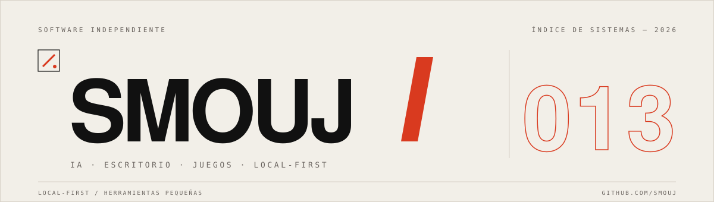

  <picture>
    <source media="(prefers-color-scheme: dark)" srcset="assets/hero-es-dark.svg">
    <source media="(prefers-color-scheme: light)" srcset="assets/hero-es-light.svg">
    
  </picture>

  <a href="https://github.com/smouj">GitHub</a> · <a href="https://huggingface.co/Smouj013">Hugging Face</a> · <a href="https://bsky.app/profile/smouj013.bsky.social">Bluesky</a> · <a href="https://discord.gg/BVWXWY5eUT">Discord</a> · <a href="README.md">English</a>

## / PERFIL

Construyo herramientas para el ordenador que tienes delante: runtimes de IA local, utilidades de Windows, herramientas para desarrolladores y juegos pequeños.

Casi todo parte de la misma restricción: tiene que funcionar offline, en hardware que la gente ya tiene, sin un servidor en la ruta crítica.

Ahora: **Kimari** (inferencia local), **Latido** (un lector de feeds más tranquilo) y **Voryda** (una suite multimedia para Windows). Además, investigando sistemas de juego en Godot.

## / SISTEMAS

### 01 / [Kimari](https://github.com/smouj/kimari-local-ai)

Runtime LLM local para GPUs de consumo. Modelos GGUF, aceleración CUDA, API compatible con OpenAI y evaluaciones reproducibles. 
↳ Python · CUDA · llama.cpp · GGUF

### 02 / [agent-browser](https://github.com/smouj/agent-browser)

Runtime de navegador y API REST que da a los agentes navegación, visión y primitivas de interacción. 
↳ TypeScript · Next.js · Playwright

### 03 / [Latido](https://github.com/smouj/latido)

Lector local-first que convierte Bluesky, HN, Reddit, Mastodon, RSS y GitHub en un único flujo tranquilo de temas emergentes. 
↳ TypeScript · React · Tauri · Rust

### 04 / [NUDO](https://github.com/smouj/nudo)

Lenguaje de programación pensado para que humanos y agentes lean, escriban y verifiquen la misma fuente. Compilador bootstrap en Rust en progreso. 
↳ Rust · Compiler design

### 05 / [Voryda Suite](https://github.com/smouj/voryda-rec)

Cuatro utilidades nativas de Windows para capturar, grabar, descargar y editar medios. Una línea de producto, sin cloud. 
↳ C# · .NET 8 · WinUI 3 · Windows · [Rec](https://github.com/smouj/voryda-rec) · [Snap](https://github.com/smouj/voryda-snap) · [Down](https://github.com/smouj/voryda-down) · [Cut](https://github.com/smouj/voryda-cut)

### 06 / [Game Development](https://github.com/smouj/romulous)

Juegos sistémicos, mecánicas retro y herramientas para experiencias basadas en ROM. Trabajo actual: Project Infest, un FPS cooperativo en desarrollo privado. 
↳ Godot · GDScript · TypeScript · ROM research · [Romulous](https://github.com/smouj/romulous) · [FerroNest](https://github.com/smouj/FerroNest) · [DBZ LSW](https://github.com/smouj/dbzlsw-fangame)

## / HERRAMIENTAS

**Lenguajes** — Python · TypeScript · C# · Rust · GDScript  
**Runtime** — llama.cpp · CUDA · GGUF · Ollama  
**Interfaz** — React · Tauri · WinUI 3 · Godot  
**Infraestructura** — Linux · Docker · SQLite · PostgreSQL

## / PRÁCTICA

**Medir antes de reescribir**  
Perfila lo real primero. Después cambia la pieza más pequeña que explique el problema.

**Offline es una característica**  
Si una herramienta necesita un servidor para ser útil, es otro producto.

**Una demo es una demo**  
Lo experimental se etiqueta. Las releases se prueban, se versionan y se pueden revertir.

## / ENLACES

**Código** — [github.com/smouj](https://github.com/smouj)  
**Modelos** — [huggingface.co/Smouj013](https://huggingface.co/Smouj013)  
**Notas** — [@smouj013](https://bsky.app/profile/smouj013.bsky.social)  
**Comunidad** — [Discord](https://discord.gg/BVWXWY5eUT)

También en <a href="https://www.threads.com/@smouj.013">Threads</a>, <a href="https://www.instagram.com/smouj.013/">Instagram</a> y <a href="https://www.reddit.com/user/SnooMarzipans9093">Reddit</a>. [Apoyar el trabajo](https://www.paypal.com/ncp/payment/XUY7RB9X2JE2G).

---

SMOUJ / 013 — software independiente

