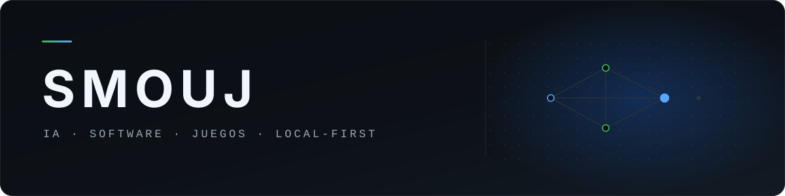
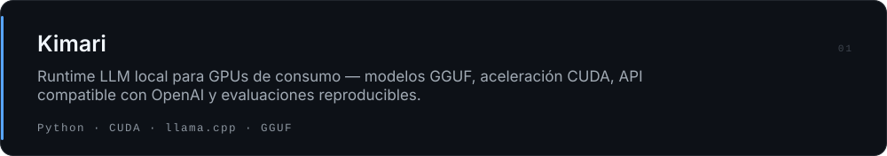
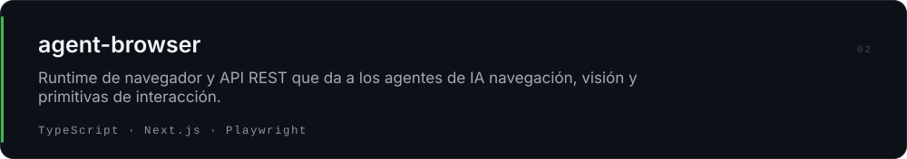
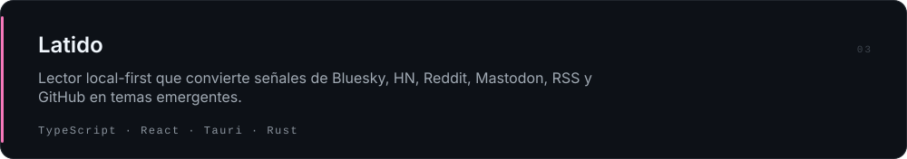
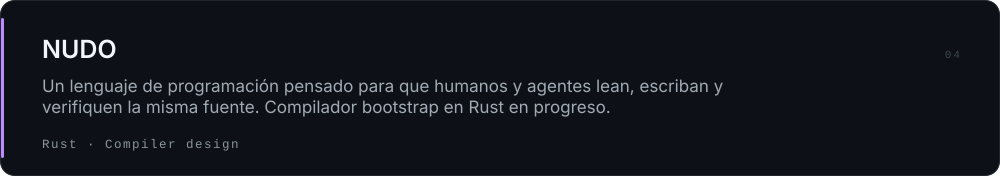
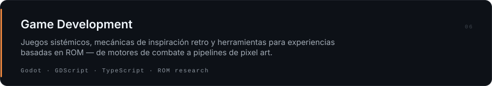

  

  <a href="https://github.com/smouj">GitHub</a> · <a href="https://huggingface.co/Smouj013">Hugging Face</a> · <a href="https://bsky.app/profile/smouj013.bsky.social">Bluesky</a> · <a href="https://discord.gg/BVWXWY5eUT">Discord</a> · <a href="README.md">English</a>

## Sobre mí

Desarrollador construyendo **sistemas de IA local-first**, **software de escritorio**, **herramientas para desarrolladores** y **juegos**. Me importa el software que sigue siendo útil sin infraestructura cloud obligatoria — y publicar trabajo que se mide, no que se anuncia.

## Trabajo seleccionado

<a href="https://github.com/smouj/voryda-rec">Rec</a> · <a href="https://github.com/smouj/voryda-snap">Snap</a> · <a href="https://github.com/smouj/voryda-down">Down</a> · <a href="https://github.com/smouj/voryda-cut">Cut</a>

<a href="https://github.com/smouj/romulous">Romulous</a> · <a href="https://github.com/smouj/FerroNest">FerroNest</a> · <a href="https://github.com/smouj/dbzlsw-fangame">DBZ LSW</a>

Project Infest — FPS cooperativo, en desarrollo privado.

## Ingeniería

**Local-first por diseño**  
El software debe seguir siendo útil sin infraestructura cloud obligatoria.

**Validado, no anunciado**  
El trabajo experimental se separa con claridad del software listo para producción.

**Cambios pequeños y reversibles**  
Auditar el estado real, acotar, probar, documentar y publicar.

## Stack principal

**Lenguajes** — Python · TypeScript · C# · Rust · GDScript

**IA y sistemas** — llama.cpp · CUDA · GGUF · Ollama · PyTorch

**Aplicaciones** — React · Tauri · WinUI 3 · Godot

**Infraestructura** — Linux · Docker · SQLite · PostgreSQL

## Más

Más de 50 repositorios públicos de IA, software de escritorio, automatización, desarrollo de juegos e investigación experimental.

[Repositorios](https://github.com/smouj?tab=repositories) · [Hugging Face](https://huggingface.co/Smouj013) · [Bluesky](https://bsky.app/profile/smouj013.bsky.social)

---

<a href="https://github.com/smouj">GitHub</a> · <a href="https://huggingface.co/Smouj013">Hugging Face</a> · <a href="https://bsky.app/profile/smouj013.bsky.social">Bluesky</a> · <a href="https://www.threads.com/@smouj.013">Threads</a> · <a href="https://www.instagram.com/smouj.013/">Instagram</a> · <a href="https://www.reddit.com/user/SnooMarzipans9093">Reddit</a> · <a href="https://discord.gg/BVWXWY5eUT">Discord</a> · <a href="https://www.paypal.com/ncp/payment/XUY7RB9X2JE2G">Apoyar</a>

