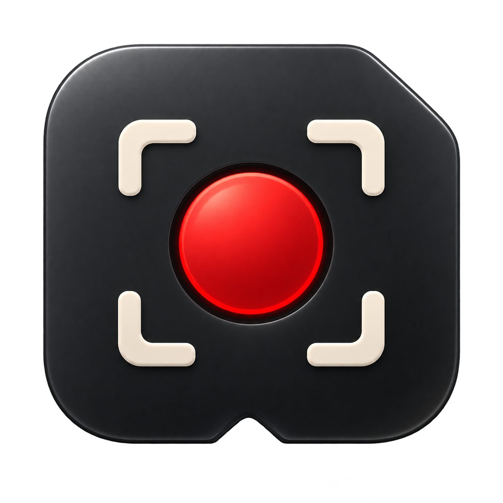
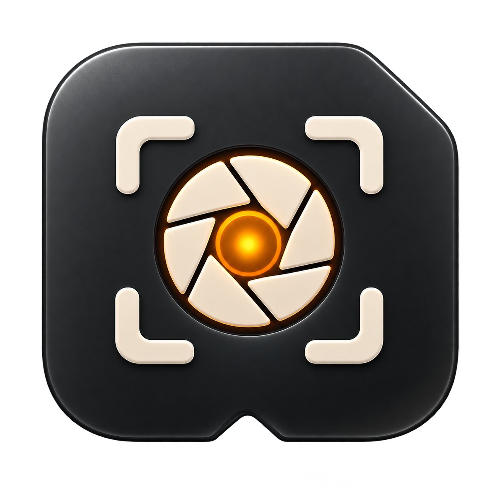
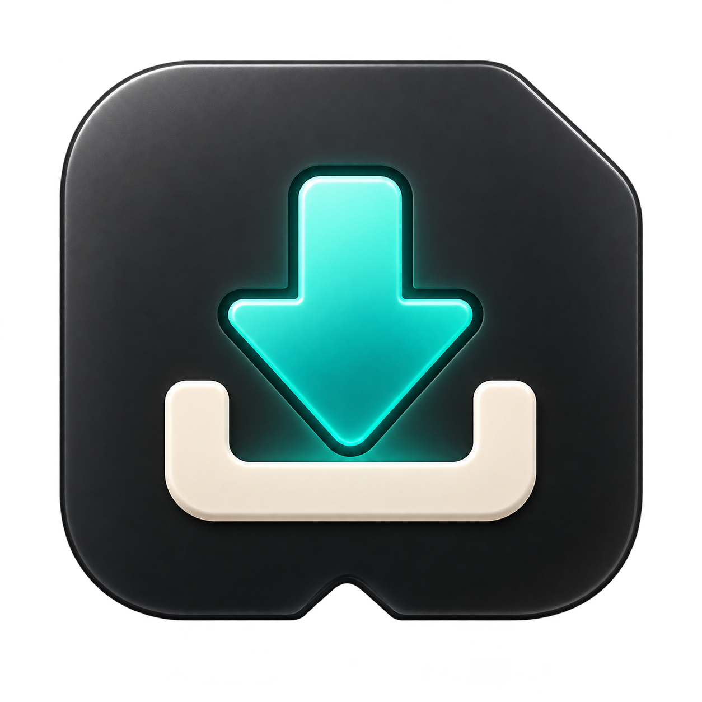
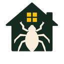
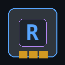

  <picture>
    <source media="(prefers-color-scheme: dark)" srcset="assets/banner-dark.png">
    <source media="(prefers-color-scheme: light)" srcset="assets/banner-light.png">
    
  </picture>

  &nbsp;
  &nbsp;
  &nbsp;
  &nbsp;
  &nbsp;
  

## Perfil

Construyo software para el ordenador que tienes delante: runtimes de IA local, utilidades de Windows, herramientas para desarrolladores y juegos pequeños.

La restricción es siempre la misma. Tiene que funcionar sin conexión, en hardware que la gente ya tiene, y tiene que poder inspeccionarse en vez de ser magia.

## Aplicaciones

Agrupadas por para qué sirven. La ejecución local es el hilo común.

🔒 privado mientras está en desarrollo

### IA local

Inferencia y herramientas de agentes que corren en la máquina, no en un centro de datos.

| | App | Qué es | Estrellas |
|:--:|:--|:--|:--:|
|  | **[Kimari](https://github.com/smouj/kimari-local-ai)** Local inference | Runtime LLM local para GPUs de consumo con CUDA y API compatible con OpenAI.    |  |
|  | **[AICodeStudio](https://github.com/smouj/AICodeStudio)** Developer IDE | IDE asistido por IA con enrutado a modelos locales y puente con OpenClaw.  |  |
|  | **[agent-browser](https://github.com/smouj/agent-browser)** Agent tooling | Runtime de navegador y API REST para navegación, visión e interacción de agentes.  |  |

### Escritorio Windows

Utilidades nativas para el equipo: monitorización, limpieza, captura y paneles de hardware.

| | App | Qué es | Estrellas |
|:--:|:--|:--|:--:|
|  | <strong>Holgura</strong> 🔒 Storage hygiene | Limpiador de Windows y WSL que enseña cada archivo antes de borrarlo. Simulacro, puerta de seguridad y cero telemetría.   | — |
|  | **[SysGlance](https://github.com/smouj/sysglance)** System monitoring | Overlay semitransparente de escritorio con CPU, GPU, disco y red en tiempo real.  |  |
|  | **[OpenClaw Widget](https://github.com/smouj/openclaw-desktop-widget)** Desktop widget | Widget sin bordes y translúcido con la salud del sistema y el panel de OpenClaw.  |  |
|  | **[LCDGlance](https://github.com/smouj/lcdglance)** Hardware panel | Páginas de monitorización y mascotas animadas para el LCD del Logitech G510.  |  |
|  | <strong>Games LCD</strong> 🔒 Hardware panel | Panel centrado en juegos para el LCD G510: estado de Heroes of Might and Magic de un vistazo.  | — |
|  | **[ClassicVoice](https://github.com/smouj/classicvoice)** Speech | Síntesis de voz multilingüe offline para Windows sobre voces de eSpeak NG.  |  |
|  | <strong>Olden Era Overlay</strong> 🔒 Game companion | Asistente contextual local para Heroes of Might and Magic: Olden Era.  | — |

### Voryda Suite

Cuatro utilidades nativas de Windows, una marca y un mismo motor de captura.

| | App | Qué es | Estrellas |
|:--:|:--|:--|:--:|
|  | **[Voryda Rec](https://github.com/smouj/voryda-rec)** Screen recording | Grabador de región de pantalla con captura nativa, sin suscripción.   |  |
|  | **[Voryda Snap](https://github.com/smouj/voryda-snap)** Screenshots | Capturas de región y pantalla completa con anotación inmediata.   |  |
|  | **[Voryda Down](https://github.com/smouj/voryda-down)** Media download | Descargador de medios construido sobre yt-dlp y FFmpeg.  |  |
|  | **[Voryda Cut](https://github.com/smouj/voryda-cut)** Video editing | Editor de vídeo para contenido social: corta, marca el ritmo y exporta.  |  |

### Adobado Kit

Suite creativa open source hecha de editores locales y enfocados. Núcleo en Rust, sin suscripción y sin subir nada.

| | App | Qué es | Estrellas |
|:--:|:--|:--|:--:|
|  | **[Adobado Kit](https://github.com/smouj/Adobado_Kit)** Creative suite | Proyecto paraguas: herramientas creativas locales derivadas de editores open source, con una sola filosofía.  |  |
|  | **[DesignAdobado](https://github.com/smouj/DesignAdobado)** Design | Diseño y composición local, derivado de DesignCraft.  |  |
|  | **[PhotoAdobado](https://github.com/smouj/PhotoAdobado)** Photo | Editor de imagen local, derivado de PhotoCraft.  |  |
|  | **[ArtAdobado](https://github.com/smouj/ArtAdobado)** Vector | Arte vectorial local, derivado de VectorCraft.  |  |
|  | **[LightAdobado](https://github.com/smouj/LightAdobado)** Photo workflow | Revelado y color local, derivado de LightCraft.  |  |
|  | **[EffectAdobado](https://github.com/smouj/EffectAdobado)** Motion | Efectos visuales locales, derivado de EffectCraft.  |  |
|  | **[FilmAdobado](https://github.com/smouj/FilmAdobado)** Video | Edición de vídeo local, derivado de FilmCraft.  |  |
|  | **[SoundAdobado](https://github.com/smouj/SoundAdobado)** Audio | Edición de audio local, derivado de SoundCraft.  |  |
|  | **[PdfAdobado](https://github.com/smouj/PdfAdobado)** Documents | Trabajo con PDF en local, derivado de PdfCraft.  |  |

### Lectura y datos

Herramientas que leen el mundo sin enviarlo a terceros.

| | App | Qué es | Estrellas |
|:--:|:--|:--|:--:|
|  | **[Latido](https://github.com/smouj/latido)** Information | Lector local-first de Bluesky, HN, Reddit, Mastodon, RSS y GitHub.    |  |
|  | <strong>DeviceLab</strong> 🔒 Device tooling | Dashboard local-first para emuladores y dispositivos Android.  | — |
|  | **[XLSX Viewer](https://github.com/smouj/xlsx-viewer)** Documents | Visor local de Excel para Windows: sin subir archivos, sin cuenta y sin macros.  |  |
|  | **[Mundial TV](https://github.com/smouj/mundial-tv)** Media | Reproductor de escritorio de televisión en directo de todo el mundo.  |  |

### Herramientas de desarrollo

Todo aquí asume que un agente leerá el código tan a menudo como una persona.

| | App | Qué es | Estrellas |
|:--:|:--|:--|:--:|
|  | **[NUDO](https://github.com/smouj/nudo)** Languages | Lenguaje para que humanos y agentes lean, escriban y verifiquen la misma fuente.  |  |
|  | **[Skill Genesis](https://github.com/smouj/skill-genesis)** Agent tooling | Generador autónomo de skills de OpenClaw a partir de una capacidad descrita.  |  |
|  | **[Prompt Organizer](https://github.com/smouj/prompt-organizer)** Workflow | Herramienta visual para organizar prompts, auditorías, bugs y backlog.  |  |
|  | **[ClawDesk](https://github.com/smouj/openclaw-desk)** Operations | Panel web local para gestionar agentes, sesiones y el estado del gateway.  |  |

### Juegos e investigación

Juegos pequeños, herramientas de ROM y motores hechos para desmontarlos.

| | App | Qué es | Estrellas |
|:--:|:--|:--|:--:|
|  | <strong>PROJECT INFEST</strong> 🔒 Game in development | FPS cooperativo de exterminio con tareas domésticas bajo presión. Godot y GDScript.   | — |
|  | **[Romulous](https://github.com/smouj/romulous)** ROM research | Desmontador de ROMs de Game Boy Color: extrae cada byte y lo explica.  |  |
|  | **[FerroNest](https://github.com/smouj/FerroNest)** Simulation | Gestión estratégica de una colonia de hormigas: diseñas reglas, no órdenes.  |  |
|  | <strong>TAGWORLD</strong> 🔒 Location game | Juego de grafiti virtual sobre un mapa del mundo real.  | — |
|  | <strong>Royal Pixel Game</strong> 🔒 Persistent world | Mundo de píxeles persistente y construido por la comunidad.  | — |
|  | <strong>Shatter Protocol</strong> 🔒 Roguelike | Breakout roguelike táctico con progresión RPG.  | — |
|  | **[DBZ LSW Fangame](https://github.com/smouj/dbzlsw-fangame)** ROM game | Fan game e investigación sobre Dragon Ball Z: Legendary Super Warriors.  |  |

### Kits y SDKs

Núcleos reutilizables extraídos de los juegos, empaquetados para que otros construyan encima.

| | App | Qué es | Estrellas |
|:--:|:--|:--|:--:|
|  | <strong>DBZ LSW Modding SDK</strong> 🔒 Modding SDK | SDK de modding ROM-first: parsea, edita y recompila sin perder un solo byte.  | — |
|  | <strong>Trading Tazos Game</strong> 🔒 Game platform | Plataforma de juego completa: cliente 3D, servidor autoritativo, PvP, chat y documentación.  [Engine](https://github.com/smouj/TTG-Engine) [Backend](https://github.com/smouj/TTG-Backend) [PvP](https://github.com/smouj/TTG-PvP) [Chat](https://github.com/smouj/TTG-Chat) [Web](https://github.com/smouj/TTG-Webpage) [Docs](https://github.com/smouj/TTG-Docs) | — |

## Práctica

| Principio | En la práctica |
|:--|:--|
| **Medir antes de reescribir** | Perfila lo real primero. Después cambia la pieza más pequeña que explique el problema. |
| **Offline es una característica** | Si una herramienta necesita un servidor para ser útil, es otro producto. |
| **Una demo es una demo** | Lo experimental se etiqueta. Las releases se prueban, se versionan y se pueden revertir. |

## Herramientas

**Lenguajes**  
    

**Runtime**  
   

**Interfaz**  
   

**Infraestructura**  
   

## Enlaces

| Canal | Dónde |
|:--|:--|
| **Código** | [github.com/smouj](https://github.com/smouj) |
| **Modelos** | [huggingface.co/Smouj013](https://huggingface.co/Smouj013) |
| **Notas** | [@smouj013](https://bsky.app/profile/smouj013.bsky.social) |
| **Comunidad** | [Discord](https://discord.gg/BVWXWY5eUT) |

También en <a href="https://www.threads.com/@smouj.013">Threads</a>, <a href="https://www.instagram.com/smouj.013/">Instagram</a> y <a href="https://www.reddit.com/user/SnooMarzipans9093">Reddit</a>. [Apoyar el trabajo](https://www.paypal.com/ncp/payment/XUY7RB9X2JE2G)

---

SMOUJ / 013 — software independiente

