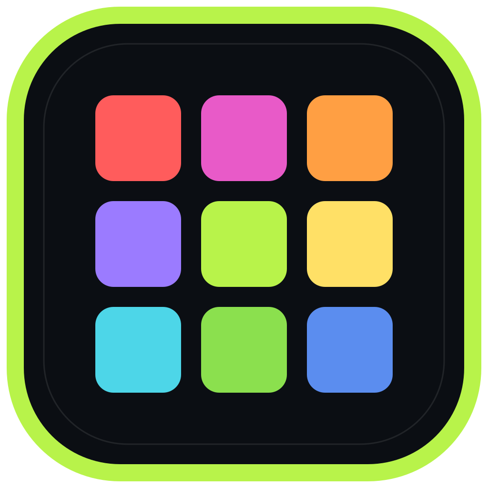

  <picture>
    <source media="(prefers-color-scheme: dark)" srcset="assets/hero-en-dark.svg?v=4">
    <source media="(prefers-color-scheme: light)" srcset="assets/hero-en-light.svg?v=4">
    
  </picture>

  &nbsp;
  &nbsp;
  &nbsp;
  &nbsp;
  &nbsp;
  

## / Profile

I build tools for the computer on the desk: local AI runtimes, Windows utilities, developer tools and small games.

Most of my work starts from the same constraint — it has to work offline, on hardware people already own, without a server in the critical path.

> **Currently** — Shipping **Holgura**, the **Adobado Kit** and **Latido**; researching game systems in Godot.

## / Selected systems

Seven groups, thirty-seven projects. Local execution is the common thread.

### / Local AI

Inference and agent plumbing that runs on the machine, not in a datacentre.

| | App | What it is | Stars |
|:--:|:--|:--|:--:|
|  | **[Kimari](https://github.com/smouj/kimari-local-ai)** Local inference | Local LLM runtime for consumer GPUs with CUDA and an OpenAI-compatible API.    |  |
|  | **[AICodeStudio](https://github.com/smouj/AICodeStudio)** Developer IDE | AI-assisted IDE with local model routing and an OpenClaw bridge.  |  |
|  | **[agent-browser](https://github.com/smouj/agent-browser)** Agent tooling | Browser runtime and REST API that gives agents navigation, vision and interaction.  |  |

### / Windows desktop

Native utilities for the machine on the desk: monitoring, cleaning, capture and hardware panels.

| | App | What it is | Stars |
|:--:|:--|:--|:--:|
|  | **[Holgura](https://github.com/smouj/holgura)** Storage hygiene | Windows and WSL cleaner that shows every file before deleting it. Dry run, safety gate, zero telemetry.   | — |
|  | **[SysGlance](https://github.com/smouj/sysglance)** System monitoring | Semi-transparent desktop overlay for real-time CPU, GPU, disk and network monitoring.  |  |
|  | **[OpenClaw Widget](https://github.com/smouj/openclaw-desktop-widget)** Desktop widget | Frameless, translucent widget with system health and the OpenClaw control panel.  | — |
|  | **[LCDGlance](https://github.com/smouj/lcdglance)** Hardware panel | Monitoring pages and animated mascots for the Logitech G510 LCD, from native code.  | — |
|  | **[Games LCD](https://github.com/smouj/games-lcd)** Hardware panel | Game-focused panel for the G510 LCD: Heroes of Might and Magic state at a glance.  | — |
|  | **[ClassicVoice](https://github.com/smouj/classicvoice)** Speech | Offline multilingual text-to-speech for Windows built on eSpeak NG voices.  | — |
|  | **[Olden Era Overlay](https://github.com/smouj/olden-era-draft-overlay)** Game companion | Contextual local assistant for Heroes of Might and Magic: Olden Era.  | — |
|  | **[Voryda Suite](https://github.com/smouj/voryda-rec)** Media suite | Four native Windows utilities for capture, recording, downloading and editing.   [Rec](https://github.com/smouj/voryda-rec) [Snap](https://github.com/smouj/voryda-snap) [Down](https://github.com/smouj/voryda-down) [Cut](https://github.com/smouj/voryda-cut) | — |

### / Adobado Kit

An open-source creative suite built from focused local editors. Rust core, no subscription, no upload.

| | App | What it is | Stars |
|:--:|:--|:--|:--:|
|  | **[Adobado Kit](https://github.com/smouj/Adobado_Kit)** Creative suite | Umbrella project: local creative tools derived from open-source editors, sharing one philosophy.  | — |
|  | **[DesignAdobado](https://github.com/smouj/DesignAdobado)** Design | Local layout and composition, derived from DesignCraft.  | — |
|  | **[PhotoAdobado](https://github.com/smouj/PhotoAdobado)** Photo | Local image editor, derived from PhotoCraft.  | — |
|  | **[ArtAdobado](https://github.com/smouj/ArtAdobado)** Vector | Local vector art, derived from VectorCraft.  | — |
|  | **[LightAdobado](https://github.com/smouj/LightAdobado)** Photo workflow | Local developing and colour work, derived from LightCraft.  | — |
|  | **[EffectAdobado](https://github.com/smouj/EffectAdobado)** Motion | Local visual effects, derived from EffectCraft.  | — |
|  | **[FilmAdobado](https://github.com/smouj/FilmAdobado)** Video | Local video editing, derived from FilmCraft.  | — |
|  | **[SoundAdobado](https://github.com/smouj/SoundAdobado)** Audio | Local audio editing, derived from SoundCraft.  | — |
|  | **[PdfAdobado](https://github.com/smouj/PdfAdobado)** Documents | Local PDF work, derived from PdfCraft.  | — |

### / Reading and data

Tools that read the world without shipping it to someone else.

| | App | What it is | Stars |
|:--:|:--|:--|:--:|
|  | **[Latido](https://github.com/smouj/latido)** Information | Local-first reader for Bluesky, HN, Reddit, Mastodon, RSS and GitHub.    | — |
|  | **[DeviceLab](https://github.com/smouj/devicelab)** Device tooling | Local-first dashboard for emulators and physical Android devices.  | — |
|  | **[XLSX Viewer](https://github.com/smouj/xlsx-viewer)** Documents | Local Excel viewer for Windows: no upload, no account, no macros.  | — |
|  | **[Mundial TV](https://github.com/smouj/mundial-tv)** Media | Desktop player for live television channels from around the world.  |  |

### / Developer tools

Everything here assumes an agent will read the source as often as a human does.

| | App | What it is | Stars |
|:--:|:--|:--|:--:|
|  | **[NUDO](https://github.com/smouj/nudo)** Languages | A language for humans and agents to read, write and verify the same source.  | — |
|  | **[Skill Genesis](https://github.com/smouj/skill-genesis)** Agent tooling | Autonomous generator of OpenClaw skills from a described capability.  |  |
|  | **[Prompt Organizer](https://github.com/smouj/prompt-organizer)** Workflow | Visual tool to organise prompts, audits, bugs and backlog in one place.  | — |
|  | **[ClawDesk](https://github.com/smouj/openclaw-desk)** Operations | Local web panel to manage agents, sessions and gateway state.  |  |

### / Games and research

Small games, ROM tooling and engines built to be taken apart.

| | App | What it is | Stars |
|:--:|:--|:--|:--:|
|  | **[PROJECT INFEST](https://github.com/smouj/project-infest)** Game in development | Co-op extermination FPS with household chores under pressure. Godot, GDScript.   | — |
|  | **[Romulous](https://github.com/smouj/romulous)** ROM research | Game Boy Color ROM unraveler: extract every byte and understand it.  | — |
|  | **[FerroNest](https://github.com/smouj/FerroNest)** Simulation | Strategic ant colony management where you design the rules, not the orders.  | — |
|  | **[TAGWORLD](https://github.com/smouj/tagworld)** Location game | Virtual graffiti game laid over a real-world map.  | — |
|  | **[Royal Pixel Game](https://github.com/smouj/royal-pixel-game)** Persistent world | Persistent, community-built pixel world.  | — |
|  | **[Shatter Protocol](https://github.com/smouj/shatter-protocol)** Roguelike | Tactical roguelike RPG breakout.  | — |
|  | **[DBZ LSW Fangame](https://github.com/smouj/dbzlsw-fangame)** ROM game | Fan game and research built on Dragon Ball Z: Legendary Super Warriors.  | — |

### / Kits and SDKs

Reusable cores extracted from the games, packaged for other people to build on.

| | App | What it is | Stars |
|:--:|:--|:--|:--:|
|  | **[DBZ LSW Modding SDK](https://github.com/smouj/dbz-lsw-modding-sdk)** Modding SDK | ROM-first modding SDK: parse, edit and recompile without losing a single byte.  | — |
|  | **[Trading Tazos Game](https://github.com/smouj/TTG-Engine)** Game platform | Full-stack game platform: 3D client, authoritative server, PvP, chat and docs.  [Engine](https://github.com/smouj/TTG-Engine) [Backend](https://github.com/smouj/TTG-Backend) [PvP](https://github.com/smouj/TTG-PvP) [Chat](https://github.com/smouj/TTG-Chat) [Web](https://github.com/smouj/TTG-Webpage) [Docs](https://github.com/smouj/TTG-Docs) | — |

## / Practice

| Principle | In practice |
|:--|:--|
| **Measure before rewriting** | Profile the real thing first. Then change the smallest piece that explains the problem. |
| **Offline is a feature** | If a tool needs a server to be useful, it is a different product. |
| **Demos are demos** | Experimental work is labeled. Releases are tested, versioned and reversible. |

## / Toolchain

**Languages**  
    

**Runtime**  
   

**Interface**  
   

**Infrastructure**  
   

## / Elsewhere

| Channel | Where |
|:--|:--|
| **Code** | [github.com/smouj](https://github.com/smouj) |
| **Models** | [huggingface.co/Smouj013](https://huggingface.co/Smouj013) |
| **Notes** | [@smouj013](https://bsky.app/profile/smouj013.bsky.social) |
| **Community** | [Discord](https://discord.gg/BVWXWY5eUT) |

Also on <a href="https://www.threads.com/@smouj.013">Threads</a>, <a href="https://www.instagram.com/smouj.013/">Instagram</a> and <a href="https://www.reddit.com/user/SnooMarzipans9093">Reddit</a>. [Support the work](https://www.paypal.com/ncp/payment/XUY7RB9X2JE2G)

---

SMOUJ / 013 — independent software

