

  <picture>
    <source media="(prefers-color-scheme: dark)" srcset="assets/banner-dark.png">
    <source media="(prefers-color-scheme: light)" srcset="assets/banner-light.png">
    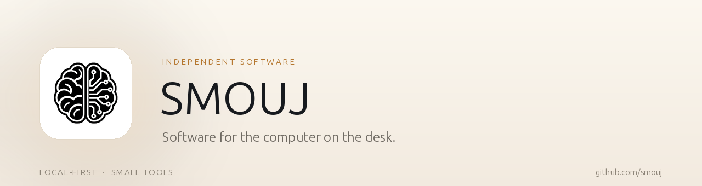
  </picture>

  &nbsp;
  &nbsp;
  &nbsp;
  &nbsp;
  &nbsp;
  

## Profile

I build software for the computer on the desk: local AI runtimes, Windows utilities, developer tools and small games.

The constraint is always the same. It has to work offline, on hardware people already own, and it has to be inspectable rather than magic.

## Applications

Grouped by what they are for. Local execution is the common thread.

### Local AI

Inference and agent plumbing that runs on the machine, not in a datacentre.

| | App | What it is | Stars |
|:--:|:--|:--|:--:|
|  | **[Kimari](https://github.com/smouj/kimari-local-ai)** Local inference | Local LLM runtime for consumer GPUs with CUDA and an OpenAI-compatible API.    |  |
| 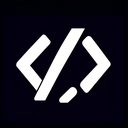 | **[AICodeStudio](https://github.com/smouj/AICodeStudio)** Developer IDE | AI-assisted IDE with local model routing and an OpenClaw bridge.  |  |
| 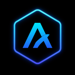 | **[agent-browser](https://github.com/smouj/agent-browser)** Agent tooling | Browser runtime and REST API that gives agents navigation, vision and interaction.  |  |

### Windows desktop

Native utilities for the machine on the desk: monitoring, cleaning, capture and hardware panels.

| | App | What it is | Stars |
|:--:|:--|:--|:--:|
|  | **[Holgura](https://github.com/smouj/holgura)** Storage hygiene | Windows and WSL cleaner that shows every file before deleting it. Dry run, safety gate, zero telemetry.   |  |
| 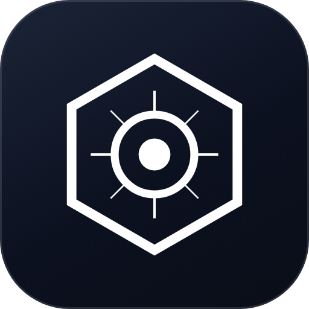 | **[SysGlance](https://github.com/smouj/sysglance)** System monitoring | Semi-transparent desktop overlay for real-time CPU, GPU, disk and network monitoring.  |  |
|  | **[OpenClaw Widget](https://github.com/smouj/openclaw-desktop-widget)** Desktop widget | Frameless, translucent widget with system health and the OpenClaw control panel.  |  |
|  | **[LCDGlance](https://github.com/smouj/lcdglance)** Hardware panel | Monitoring pages and animated mascots for the Logitech G510 LCD, from native code.  |  |
|  | **[ClassicVoice](https://github.com/smouj/classicvoice)** Speech | Offline multilingual text-to-speech for Windows built on eSpeak NG voices.  |  |

### TV and wearables

Local tools for Android TV and GloryFit-family smartwatches.

| | App | What it is | Stars |
|:--:|:--|:--|:--:|
|  | **[Tervia](https://github.com/smouj/tervia)** Android TV | Alpha Windows app for customizing Android TV home screens and discovering TVs on the local network.  |  |
|  | **[My Dev Watch](https://github.com/smouj/my-dev-watch)** Smartwatch companion | Local-first Android companion, watch-face studio and BLE lab for GloryFit-family smartwatches; early alpha.   |  |

### Voryda Suite

Four focused native Windows utilities under one visual identity.

| | App | What it is | Stars |
|:--:|:--|:--|:--:|
|  | **[Voryda Rec](https://github.com/smouj/voryda-rec)** Screen recording · alpha | Records a selected desktop region to H.264/MP4 using Windows Graphics Capture, DXGI and Media Foundation.   |  |
|  | **[Voryda Snap](https://github.com/smouj/voryda-snap)** Screenshots | Captures a region, the primary display or a window; copies to the clipboard or saves PNG/JPEG.   |  |
|  | **[Voryda Down](https://github.com/smouj/voryda-down)** Media downloads | A Windows frontend for yt-dlp, with FFmpeg for workflows that need merging or media processing.   |  |
|  | **[Voryda Cut](https://github.com/smouj/voryda-cut)** Video editing · pre-alpha | An early WinUI 3 editor foundation; the editing UI and export workflow are still in development.   |  |

### Adobado Kit

An open-source creative suite built from focused local editors. Rust core, no subscription, no upload.

| | App | What it is | Stars |
|:--:|:--|:--|:--:|
| 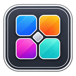 | **[Adobado Kit](https://github.com/smouj/Adobado_Kit)** Creative suite | Umbrella project: local creative tools derived from open-source editors, sharing one philosophy.  |  |
| 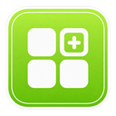 | **[DesignAdobado](https://github.com/smouj/DesignAdobado)** Design | Local layout and composition, derived from DesignCraft.  |  |
| 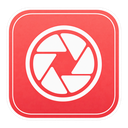 | **[PhotoAdobado](https://github.com/smouj/PhotoAdobado)** Photo | Local image editor, derived from PhotoCraft.  |  |
| 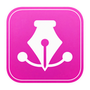 | **[ArtAdobado](https://github.com/smouj/ArtAdobado)** Vector | Local vector art, derived from VectorCraft.  |  |
| 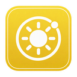 | **[LightAdobado](https://github.com/smouj/LightAdobado)** Photo workflow | Local developing and colour work, derived from LightCraft.  |  |
| 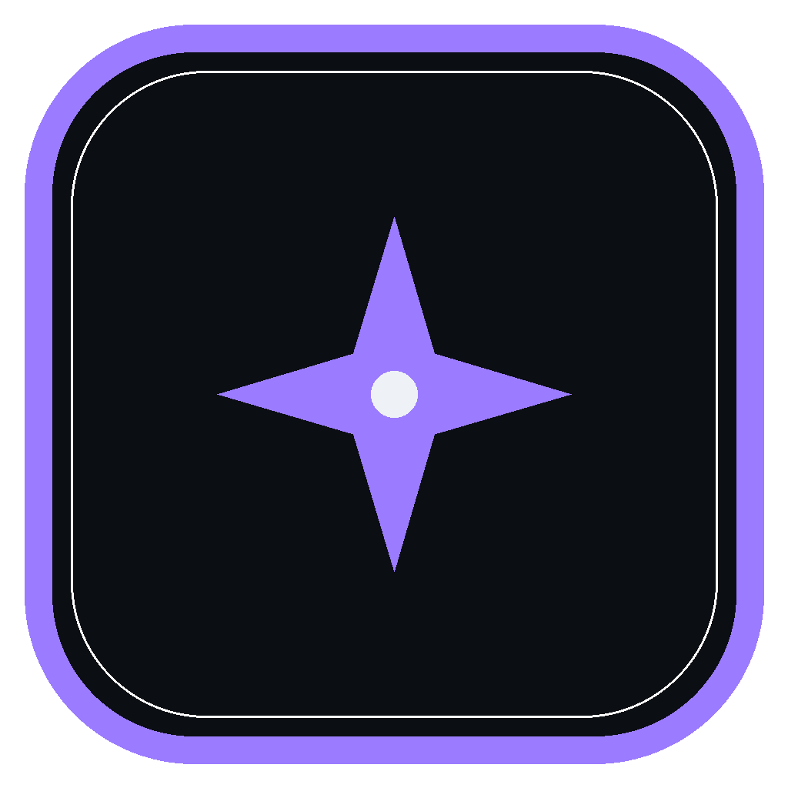 | **[EffectAdobado](https://github.com/smouj/EffectAdobado)** Motion | Local visual effects, derived from EffectCraft.  |  |
|  | **[FilmAdobado](https://github.com/smouj/FilmAdobado)** Video | Local video editing, derived from FilmCraft.  |  |
| 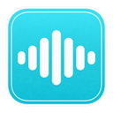 | **[SoundAdobado](https://github.com/smouj/SoundAdobado)** Audio | Local audio editing, derived from SoundCraft.  |  |
|  | **[PdfAdobado](https://github.com/smouj/PdfAdobado)** Documents | Local PDF work, derived from PdfCraft.  |  |

### Reading and data

Tools that read the world without shipping it to someone else.

| | App | What it is | Stars |
|:--:|:--|:--|:--:|
|  | **[Latido](https://github.com/smouj/latido)** Information | Local-first reader for Bluesky, HN, Reddit, Mastodon, RSS and GitHub.    |  |
| 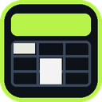 | **[XLSX Viewer](https://github.com/smouj/xlsx-viewer)** Documents | Local Excel viewer for Windows: no upload, no account, no macros.  |  |
| 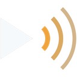 | **[Mundial TV](https://github.com/smouj/mundial-tv)** Media | Desktop player for live television channels from around the world.  |  |

### Developer tools

Everything here assumes an agent will read the source as often as a human does.

| | App | What it is | Stars |
|:--:|:--|:--|:--:|
| 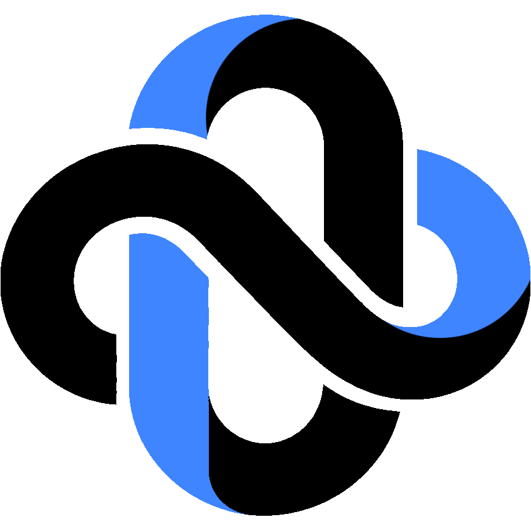 | **[NUDO](https://github.com/smouj/nudo)** Languages | A language for humans and agents to read, write and verify the same source.  |  |

## Practice

| Principle | In practice |
|:--|:--|
| **Measure before rewriting** | Profile the real thing first. Then change the smallest piece that explains the problem. |
| **Offline is a feature** | If a tool needs a server to be useful, it is a different product. |
| **Demos are demos** | Experimental work is labeled. Releases are tested, versioned and reversible. |

## Toolchain

**Languages**  
     

**Runtime**  
   

**Interface**  
    

**Infrastructure**  
   

## Elsewhere

| Channel | Where |
|:--|:--|
| **Code** | [github.com/smouj](https://github.com/smouj) |
| **Models** | [huggingface.co/Smouj013](https://huggingface.co/Smouj013) |
| **Notes** | [@smouj013](https://bsky.app/profile/smouj013.bsky.social) |
| **Community** | [Discord](https://discord.gg/BVWXWY5eUT) |

Also on <a href="https://www.threads.com/@smouj.013">Threads</a>, <a href="https://www.instagram.com/smouj.013/">Instagram</a> and <a href="https://www.reddit.com/user/SnooMarzipans9093">Reddit</a>. [Support the work](https://www.paypal.com/ncp/payment/XUY7RB9X2JE2G)

---

SMOUJ / 013 — independent software

