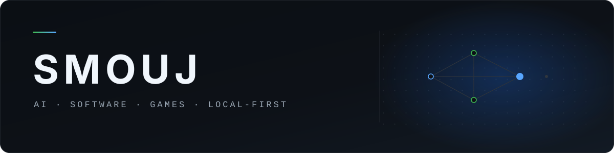
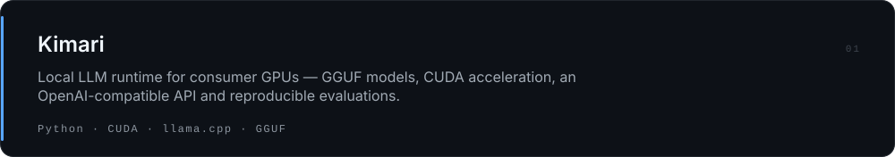
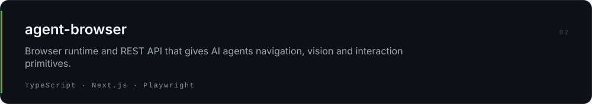
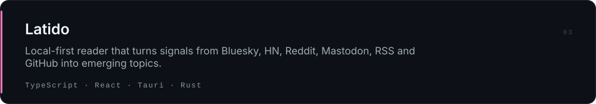
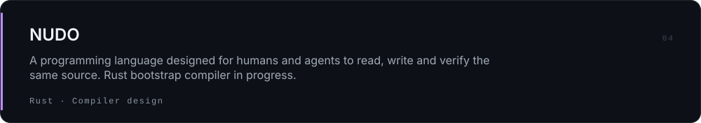
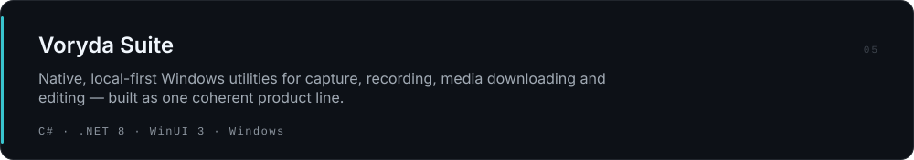

  

  <a href="https://github.com/smouj">GitHub</a> · <a href="https://huggingface.co/Smouj013">Hugging Face</a> · <a href="https://bsky.app/profile/smouj013.bsky.social">Bluesky</a> · <a href="https://discord.gg/BVWXWY5eUT">Discord</a> · <a href="README.es.md">Español</a>

## About

Developer building **local-first AI systems**, **desktop software**, **developer tools** and **games**. I care about software that stays useful without mandatory cloud infrastructure — and about shipping work that is measured rather than advertised.

## Selected work

<a href="https://github.com/smouj/voryda-rec">Rec</a> · <a href="https://github.com/smouj/voryda-snap">Snap</a> · <a href="https://github.com/smouj/voryda-down">Down</a> · <a href="https://github.com/smouj/voryda-cut">Cut</a>

<a href="https://github.com/smouj/romulous">Romulous</a> · <a href="https://github.com/smouj/FerroNest">FerroNest</a> · <a href="https://github.com/smouj/dbzlsw-fangame">DBZ LSW</a>

Project Infest — cooperative FPS, in private development.

## Engineering

**Local-first by design**  
Software should remain useful without mandatory cloud infrastructure.

**Validated over advertised**  
Experimental work is clearly separated from production-ready software.

**Small, reversible changes**  
Audit the real state, scope tightly, test, document, release.

## Core stack

**Languages** — Python · TypeScript · C# · Rust · GDScript

**AI & systems** — llama.cpp · CUDA · GGUF · Ollama · PyTorch

**Applications** — React · Tauri · WinUI 3 · Godot

**Infrastructure** — Linux · Docker · SQLite · PostgreSQL

## More

50+ public repositories across AI, desktop software, automation, game development and experimental research.

[Repositories](https://github.com/smouj?tab=repositories) · [Hugging Face](https://huggingface.co/Smouj013) · [Bluesky](https://bsky.app/profile/smouj013.bsky.social)

---

<a href="https://github.com/smouj">GitHub</a> · <a href="https://huggingface.co/Smouj013">Hugging Face</a> · <a href="https://bsky.app/profile/smouj013.bsky.social">Bluesky</a> · <a href="https://www.threads.com/@smouj.013">Threads</a> · <a href="https://www.instagram.com/smouj.013/">Instagram</a> · <a href="https://www.reddit.com/user/SnooMarzipans9093">Reddit</a> · <a href="https://discord.gg/BVWXWY5eUT">Discord</a> · <a href="https://www.paypal.com/ncp/payment/XUY7RB9X2JE2G">Support</a>

